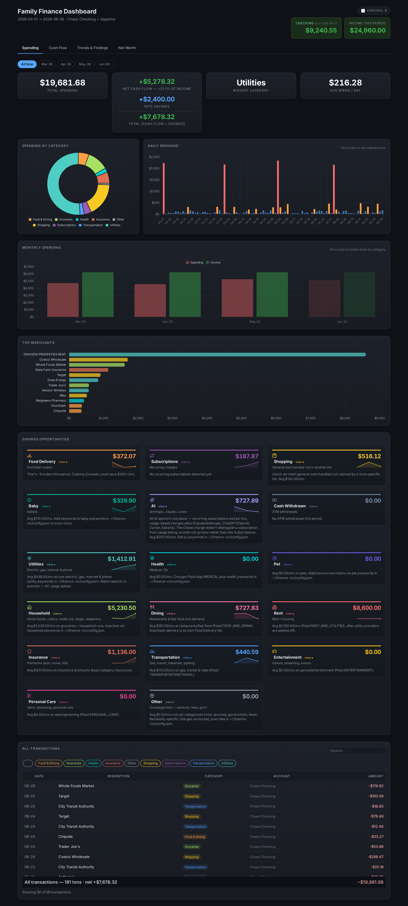
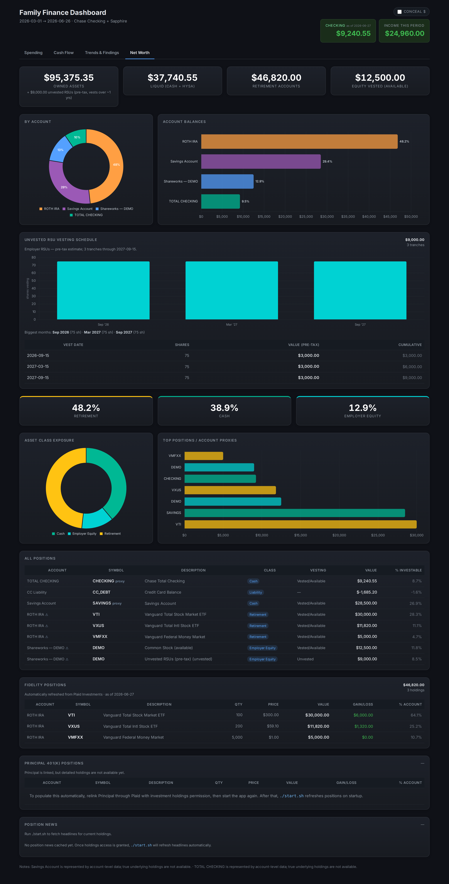

# Finance Dashboard

A self-hosted personal finance dashboard: live bank/brokerage data via **Plaid**,
equity-plan scraping for what Plaid can't reach, and a local **Flask** dashboard.
All financial data stays on your machine — the repo never contains balances,
transactions, or secrets.

[](https://github.com/barnabys-drew/finance-dashboard-template/actions/workflows/ci.yml)


| Spending | Net Worth |
|----------|-----------|
|  |  |

_All figures shown are generated sample data._

## Try it in 60 seconds

No Plaid account, credentials, or configuration needed:

```bash
git clone https://github.com/barnabys-drew/finance-dashboard-template.git
cd finance-dashboard-template
python3 -m venv venv && source venv/bin/activate && pip install -r requirements.txt
./start.sh --demo
```

That generates realistic sample data and opens the full dashboard at
`http://localhost:5000`.

## Features

- **Spending** — monthly drill-down, category donut, top merchants, daily chart,
  and keyword-driven insight tiles (Household, Baby, Pet, AI, Utilities, …) with
  optional per-tile budgets
- **Net Worth** — account balances, asset-class exposure, concentration alerts,
  vested vs. unvested employer equity with a per-tranche vesting schedule
- **Cash Flow & Trends** — income vs. spend, month-over-month deltas,
  subscription detection (price changes, lapsed, emerging), anomaly findings
- **Recurring-charge scan** — flags stable monthly/annual merchants, splits true
  subscriptions from bills
- **Position news** — Yahoo Finance headlines for your current holdings

## How it works

```
Plaid API ──────────────┐
Equity plan scraper ────┤            ~/.finance-viz/*.json           Flask
(Playwright + Chrome)   ├─ refresh.py ─────────────────────► app.py ───► localhost:5000
Pharmacy Rx scraper ────┤   (orchestrator)                  (read-only)
Manual entries ─────────┘
```

- **Everything personal lives in `~/.finance-viz/`** (data, tokens, config) —
  gitignored, chmod-600, never in the repo.
- **Code contains no personal data.** Category rules, merchant keywords, account
  labels, employer tickers, and budgets all come from `config.json`
  (see [`config.example.json`](config.example.json)).
- Secrets come from a local file or the 1Password CLI at runtime — never
  hardcoded, never logged.

## Setup with your real accounts

Follow **[SETUP.md](SETUP.md)** — it covers Plaid onboarding, linking accounts,
the full `config.json` reference, and adding scrapers for institutions Plaid
doesn't reach. It's written step-by-step, so you can also hand it to an AI
coding assistant and have it walk you through the process.

## Running it

| Command | What it does |
|---------|--------------|
| `./start.sh` | Refresh all sources, then open the dashboard |
| `./start.sh --fast` | Skip refresh — cached data, instant |
| `./start.sh --demo` | Generated sample data — no credentials at all |
| `./start.sh --no-shareworks` | Refresh Plaid only; don't touch Chrome |

`RUN.md` documents the runtime details (Chrome remote-debugging flow for
scrapers, Tailwind build, WSL specifics).

## Key files

| File | Purpose |
|------|---------|
| `app.py` | Flask app + API routes |
| `finance_config.py` | Paths, category rules, config loading, bucket classifier |
| `refresh.py` | Orchestrates all data sources |
| `plaid_setup.py` / `plaid_refresh.py` | One-time account linking / incremental sync |
| `providers/` | Pluggable balance providers (Shareworks scraper, manual entries) |
| `portfolio_analytics.py` | Asset-class exposure + concentration alerts |
| `detect_subscriptions.py` / `detect_anomalies.py` | Recurring-charge + anomaly scans |
| `scripts/gen_sample_data.py` | Demo data generator (powers `--demo` and CI) |
| `static/app.js`, `templates/` | Dashboard front-end (Chart.js + Tailwind) |

## Tests

```bash
pip install -r requirements-dev.txt
python3 -m pytest -q
```

## License

MIT
